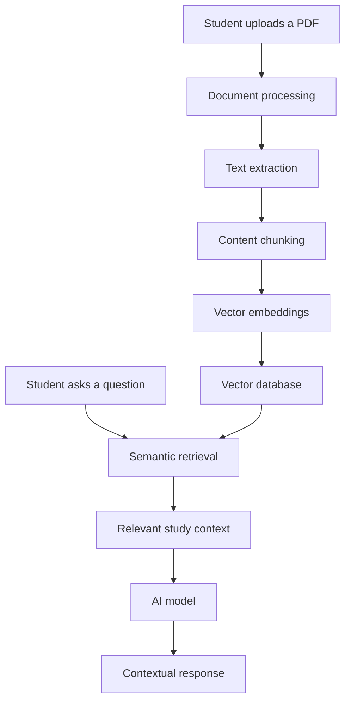

# AVEN StudyPartner

### Adaptive Intelligence for Student Learning

**A smarter way to learn, practice, and grow.**

AVEN StudyPartner is an AI-powered learning platform designed to make studying more personalized, interactive, and effective. It transforms learning materials into meaningful study resources, helps students understand difficult concepts, and creates a more structured approach to academic preparation.

Instead of simply storing notes or delivering generic AI responses, AVEN brings learning, practice, and revision together in one student-focused environment.

<p align="center">
  <a href="https://aven-studypartner.onrender.com/">
    <strong>Explore AVEN →</strong>
  </a>
</p>

---

## About the Project

Traditional learning platforms often focus on organizing courses, uploading materials, and tracking assignments. However, students still have to figure out how to understand, revise, and practice the material themselves.

AVEN StudyPartner was created to address this gap.

The platform uses artificial intelligence to help students turn their learning materials into useful academic resources. Whether a student is preparing for an examination, revising a difficult topic, or trying to understand a concept, AVEN aims to make the process more accessible and organized.

The core idea behind AVEN is simple:

> Learning should not stop at accessing information. It should help students understand, remember, practice, and improve.

AVEN stands for **Adaptive Intelligence for Student Learning**.

## Why AVEN?

Students face several challenges during their academic journey:

- Large amounts of study material that are difficult to organize.
- Limited time for examination preparation.
- Difficulty understanding complex concepts.
- Repetitive manual work when creating notes, quizzes, and flashcards.
- A lack of personalized learning support.
- The challenge of identifying what to revise and practice next.

AVEN aims to reduce these challenges by combining AI-powered assistance with structured learning resources.

The goal is not to replace teachers or independent learning. It is to provide students with an intelligent study companion that makes learning more efficient and engaging.

---

## Key Features

### 1. AI-Powered Study Assistance

Get assistance with academic topics, concepts, and study-related questions.

AVEN is designed to provide learning-oriented responses that help students understand the subject rather than simply receive an answer.

### 2. PDF-Based Learning

Turn uploaded study materials into useful learning resources.

AVEN can work with academic documents to help students study from their own material instead of relying exclusively on generic information.

Supported learning workflows include:

- Study material analysis.
- AI-generated summaries.
- Quiz generation.
- Flashcard generation.
- Document-based question answering.

### 3. Intelligent Document Retrieval

AVEN incorporates retrieval-based AI techniques to make document-based learning more relevant.

Instead of relying only on a general-purpose AI model, the platform can retrieve relevant information from processed study materials and use that information to support its responses.

This helps connect AI assistance with the student's actual learning content.

### 4. AI-Generated Quizzes

Practice concepts through automatically generated questions based on learning materials.

Quizzes help students:

- Test their understanding.
- Identify knowledge gaps.
- Reinforce important concepts.
- Prepare for examinations.

### 5. Smart Flashcards

Convert study material into flashcards for active recall and revision.

Flashcards are intended to focus on meaningful academic content rather than irrelevant document elements such as headers, footers, or page numbers.

### 6. AI-Generated Summaries

Make large study documents easier to approach through concise summaries.

The objective is to help students identify important concepts and revise more efficiently while retaining the context of the original material.

### 7. Student-Focused Learning Experience

AVEN is designed around the actual needs of students.

The platform emphasizes a practical learning workflow:

**Upload → Understand → Practice → Revise → Improve**

Each stage is intended to make academic preparation more manageable.

---

## How It Works

<details>
<summary><strong>Step 1 — Access the learning platform</strong></summary>

Visit AVEN StudyPartner and access the learning environment.

</details>

<details>
<summary><strong>Step 2 — Provide your learning material</strong></summary>

Upload relevant study documents or work with an academic topic.

</details>

<details>
<summary><strong>Step 3 — Generate learning resources</strong></summary>

Use AI-powered tools to transform the material into summaries, quizzes, flashcards, or contextual answers.

</details>

<details>
<summary><strong>Step 4 — Study and practice</strong></summary>

Use the generated resources to understand concepts, revise important information, and test your knowledge.

</details>

<details>
<summary><strong>Step 5 — Continue improving</strong></summary>

Build a more structured study routine by combining learning, revision, and practice.

</details>

---

## Technology Stack

AVEN combines modern web development technologies with AI-powered document processing.

| Technology | Purpose |
|---|---|
| JavaScript / Node.js | Application logic and server-side functionality |
| Web technologies | Interactive user interface |
| PostgreSQL | Structured application data and persistent storage |
| Vector retrieval | Semantic search across processed study materials |
| Large Language Models (LLMs) | AI-powered learning assistance and content generation |
| Groq | AI inference integration |
| Supabase | Database infrastructure and supporting services |
| Render | Application hosting and deployment |

The architecture brings together application development, database systems, information retrieval, and generative AI to support a practical learning experience.

---

## AI and Retrieval Architecture

One of the important technical aspects of AVEN is its use of retrieval-based learning workflows.

A simplified representation of the document-processing pipeline is:



The retrieval workflow helps the AI system use relevant information from a student's study materials when generating responses.

This approach is particularly useful for academic documents, where answers should be connected to the material being studied.

---

## Getting Started

Follow these instructions to run AVEN StudyPartner locally.

### Prerequisites

Make sure you have the following installed:

- [Node.js](https://nodejs.org/)
- npm
- Git
- Access to the required database
- An API key for the configured AI provider

### 1. Clone the repository

```bash
git clone https://github.com/EthicalMaster/Aven-studypartner.git
```

### 2. Navigate to the project directory

```bash
cd Aven-studypartner
```

### 3. Install dependencies

```bash
npm ci
```

### 4. Configure environment variables

Create a local environment configuration file using the project's provided environment template.

```bash
cp .env.example .env
```

If the project does not contain an `.env.example` file, create the configuration file using the environment variables documented in the project.

Configure the required database connection, AI provider credentials, and other application settings.

**Important:** Never commit API keys, database passwords, access tokens, or other secrets to GitHub.

### 5. Set up the database

Configure the required PostgreSQL database and apply the database migrations provided by the project.

Make sure the database connection and retrieval infrastructure are correctly configured before testing document-based AI features.

### 6. Start the development server

```bash
npm run dev
```

Open the local URL displayed in your terminal to access the application.

---

## Project Structure

AVEN is organized around the core components of a modern AI-powered learning platform.

The major architectural responsibilities include:

| Component | Responsibility |
|---|---|
| Frontend | Student-facing interface and learning interactions |
| Backend | Application logic, requests, and AI workflows |
| Database | Persistent storage of application data |
| Retrieval system | Relevant information retrieval from learning materials |
| AI integration | Generation of learning resources and contextual responses |
| Deployment | Hosting and application availability |

The exact directory structure and implementation details can be explored directly in the repository.

---

## Live Application

Experience AVEN StudyPartner:

**[https://aven-studypartner.onrender.com/](https://aven-studypartner.onrender.com/)**

The application is deployed on Render.

Note: As the application uses a free hosting environment, initial loading may take longer if the service has been inactive.

---

## Development Philosophy

AVEN is built around a few fundamental principles.

**Student-first design**

Technology should adapt to the needs of learners, not force students to adapt to complicated systems.

**Learning over information delivery**

Providing information is only the beginning. Effective learning also requires understanding, practice, revision, and improvement.

**Context-aware AI**

AI assistance becomes more useful when it understands the material a student is actually studying.

**Practical accessibility**

Learning tools should reduce unnecessary effort and make academic preparation easier to manage.

**Continuous improvement**

AVEN is an evolving project, with its features and architecture developed to support increasingly useful learning experiences.

---

## Future Vision

AVEN aims to evolve into a more comprehensive AI-powered learning environment.

Potential areas of continued development include:

- More personalized learning workflows.
- Improved academic question answering.
- Enhanced examination preparation tools.
- Better revision and active-recall experiences.
- More intelligent learning-resource generation.
- Deeper integration of academic context.
- Improved learning progress and performance insights.

The long-term vision is to make AVEN a reliable digital study companion that supports students throughout their academic journey.

---

## Contributing

Contributions, suggestions, and feedback are welcome.

If you are interested in improving AVEN StudyPartner:

1. Fork the repository.
2. Create a new branch for your changes.
3. Make your improvements.
4. Test your changes.
5. Submit a pull request describing your contribution.

For significant changes, consider opening an issue first to discuss the proposed improvement.

Please ensure that contributions maintain the project's focus on useful, accessible, and student-centered learning.

---

## Author

**Taher Saifee**

B.Tech CSE — Data Science

Acropolis Institute of Technology and Research, Indore

Interested in artificial intelligence, data science, and building practical software that solves real-world problems.

- GitHub: [EthicalMaster](https://github.com/EthicalMaster)
- LinkedIn: [Taher Saifee](https://www.linkedin.com/in/taher-saifee/)

---

## License

The licensing terms for AVEN StudyPartner are determined by the license included in this repository.

If no license file is present, the project should not be assumed to be open for unrestricted redistribution or commercial use.

---

<p align="center">
  <strong>AVEN StudyPartner</strong>
  <br/>
  Adaptive Intelligence for Student Learning
  <br/>
  <em>Learn smarter. Practice better. Grow continuously.</em>
</p>
